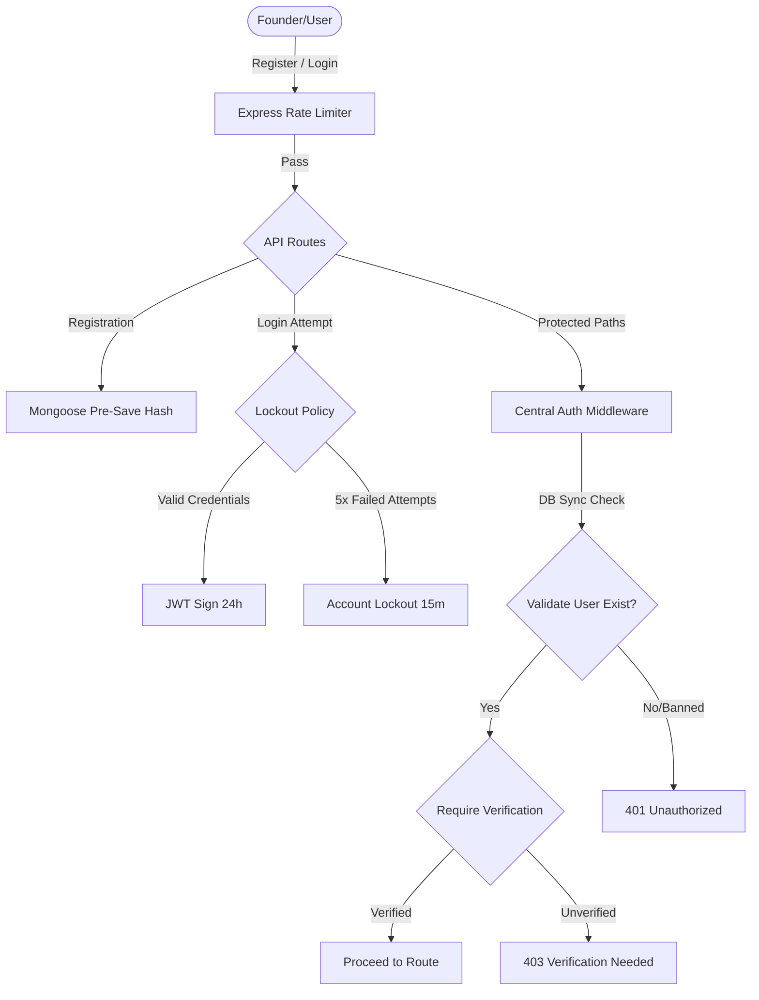

# Implementation Plan - Secure Authentication System Overhaul

This document outlines the proposed security refactoring and engineering plan to transform the Beacon authentication system into a secure, production-ready enterprise gateway.

## Goal Description
The current authentication implementation has several architectural and security vulnerabilities:
1. **Duplicate Auth Middleware**: Every route file has its own duplicate implementation of JWT validation. This creates a severe security risk and makes the application harder to maintain.
2. **Missing Mongoose Pre-save Hashing**: Passwords are manually hashed inside routes, creating potential vulnerabilities if developer mistakes bypass salting/hashing in new routes.
3. **No Email Verification**: Accounts can log in and perform critical operations instantly without verifying email addresses.
4. **No Password Reset Flow**: There is no mechanism for users to securely recover their accounts.
5. **No Rate Limiting or Account Lockout**: Bruteforcing login endpoints is currently unrestricted, leaving accounts vulnerable to credential stuffing.
6. **Stale Token Vulnerabilities**: JWT verification does not query the database, allowing deleted, banned, or unverified users with existing tokens to access APIs for 7 days.
7. **Secrets Exposure Concerns**: Standard database errors and full server stack traces are returned to the client on server failure (500 errors).

We will act as senior security engineers to secure the entire auth lifecycle by consolidating authentication middleware, enforcing pre-save password hooks, establishing email verification, securing account recovery, implementing lockout parameters, and introducing backend and frontend level defensive safeguards.

---

## User Review Required

> [!WARNING]
> **Shortened Session Expired Duration**
> We are reducing the active JWT token lifespan from **7 days** (`7d`) to **24 hours** (`24h`). This aligns with industry-standard session management guidelines to limit the exposure window of hijacked tokens. Active sessions will expire automatically after 24 hours.

> [!NOTE]
> **Email Verification Console Log Fallback**
> In local development environments where SMTP servers are not configured, all verification links and password recovery links will automatically fallback to logging on the backend server console. This allows rapid developer testing without setting up external mail relays.

---

## Open Questions
None. The design is fully aligned with OWASP-10 security guidelines and matches the technology stack of Beacon.

---

## Proposed Changes

### 1. Backend Security Enhancements

#### [NEW] [auth.js](file:///Users/shahpershahin/Downloads/Study/B.Tech/SEM%202/startup-dashboard/backend/middleware/auth.js)
* Create a dedicated middleware file defining two robust, secure middlewares:
  1. `auth`: Parses `x-auth-token`, verifies JWT, fetches user from database, attaches full `req.user` payload, and handles errors.
  2. `requireVerified`: Blocks users whose `isVerified` is false, returning `403 Forbidden` with a security payload.

#### [MODIFY] [User.js](file:///Users/shahpershahin/Downloads/Study/B.Tech/SEM%202/startup-dashboard/backend/models/User.js)
* Upgrade schema properties to include:
  * `isVerified`: `{ type: Boolean, default: false }`
  * `verificationToken`: `{ type: String }`
  * `verificationTokenExpires`: `{ type: Date }`
  * `resetPasswordToken`: `{ type: String }`
  * `resetPasswordExpires`: `{ type: Date }`
  * `loginAttempts`: `{ type: Number, required: true, default: 0 }`
  * `lockUntil`: `{ type: Date }`
* Add mongoose pre-save hook to hash password automatically when modified.
* Add helper instance methods for `comparePassword`, `incLoginAttempts`, and `resetAttempts`.

#### [NEW] [email.js](file:///Users/shahpershahin/Downloads/Study/B.Tech/SEM%202/startup-dashboard/backend/utils/email.js)
* Create utility to send emails via `nodemailer` using standard SMTP credentials.
* Gracefully fallback to console logging verification/reset urls in local mode if `.env` variables are missing.

#### [MODIFY] [auth.js](file:///Users/shahpershahin/Downloads/Study/B.Tech/SEM%202/startup-dashboard/backend/routes/auth.js)
* Clean out the duplicated `auth` middleware.
* Apply central `auth` middleware to profile and update routes.
* Refactor `/register` to generate a secure random hex verification token and verification expiration date, send the email via the email utility, and return safe payloads.
* Refactor `/login` to check for account lockouts, increment lockout tries on authentication failure, and reset attempts on successful validation.
* Shorten JWT tokens lifespan to `24h`.
* Implement securely hashed password reset tokens inside:
  * `/forgot-password`: requests and emails a secure reset link.
  * `/reset-password/:token`: validates expired status and updates password.
* Implement `/verify-email/:token` endpoint to handle status conversions.
* Strip verbose database errors (`err.message`) from output payloads.

#### [MODIFY] [ai.js](file:///Users/shahpershahin/Downloads/Study/B.Tech/SEM%202/startup-dashboard/backend/routes/ai.js)
* Import central `auth` middleware. Remove internal duplicate middleware.
* Enforce `requireVerified` on the generative AI analysis endpoint `/analyze` so that unverified users cannot consume API resource budgets.

#### [MODIFY] [docs.js](file:///Users/shahpershahin/Downloads/Study/B.Tech/SEM%202/startup-dashboard/backend/routes/docs.js)
* Import central `auth` middleware. Remove internal duplicate middleware.

#### [MODIFY] [startup.js](file:///Users/shahpershahin/Downloads/Study/B.Tech/SEM%202/startup-dashboard/backend/routes/startup.js)
* Import central `auth` and `requireVerified` middlewares. Remove internal duplicate middleware.
* Enforce `requireVerified` on creation, deletion, or team addition/removal routes.

#### [MODIFY] [server.js](file:///Users/shahpershahin/Downloads/Study/B.Tech/SEM%202/startup-dashboard/backend/server.js)
* Implement global rate-limit middleware from `express-rate-limit` targeted directly at authentication endpoints `/api/auth` to prevent automated brute-force scripts.

---

### 2. Frontend User Interface Upgrades

#### [MODIFY] [providers.js](file:///Users/shahpershahin/Downloads/Study/B.Tech/SEM%202/startup-dashboard/frontend/app/providers.js)
* Implement a global fetch hook/interceptor. When any API response returns a `401 Unauthorized` status (e.g. token expired), automatically clear `token` and `user` state from `localStorage` and redirect the viewport to `/login?expired=true` with a beautiful toast notification.

#### [MODIFY] [layout.js](file:///Users/shahpershahin/Downloads/Study/B.Tech/SEM%202/startup-dashboard/frontend/app/dashboard/layout.js)
* Fetch fresh profile details on mount from `/api/auth/profile` to capture changes in account verification or roles.
* Render a highly polished, interactive sticky banner at the top of the dashboard page if the user's email is unverified (`!user.isVerified`). Include an action button to resend verification link with beautiful success/failure toast responses.

#### [NEW] [page.js](file:///Users/shahpershahin/Downloads/Study/B.Tech/SEM%202/startup-dashboard/frontend/app/verify-email/page.js)
* Create a dedicated `/verify-email` endpoint routing.
* Load a premium animated loader card, make a call to `GET /api/auth/verify-email/:token`, and display a success checkmark or error alert with redirection buttons.

#### [NEW] [page.js](file:///Users/shahpershahin/Downloads/Study/B.Tech/SEM%202/startup-dashboard/frontend/app/forgot-password/page.js)
* Beautiful interactive UI request form to recover accounts.

#### [NEW] [page.js](file:///Users/shahpershahin/Downloads/Study/B.Tech/SEM%202/startup-dashboard/frontend/app/reset-password/page.js)
* Beautiful interactive UI update form to establish a new password.

---

## Verification Plan

### Automated Tests
1. Verify express startup: Run `npm run dev` inside both frontend and backend directories to ensure compiles complete successfully.
2. Verify security constraints on the backend using targeted REST queries or checking logs.

### Manual Verification
1. **Password Hashing**: Register a user, check MongoDB to verify that passwords are saved as `$2a$10$...` hashes.
2. **Session Expiration**: Log in, capture a JWT token, edit its expiration or wait for 24h, verify that accessing dashboard automatically triggers a redirection to `/login`.
3. **Email Verification Flow**:
   - Register a new account.
   - Verify that an unverified banner appears on the top of the dashboard.
   - Confirm that the email verification link is printed on the backend terminal logs.
   - Copy the verification link, open it in the browser, and ensure that the `/verify-email` page successfully completes registration.
   - Refresh the dashboard to see that the verification banner is cleanly removed.
4. **Account Lockout**: Attempt to log in with an incorrect password 5 times. Verify that the account is locked and subsequent correct attempts are rejected with a lockout cooldown warning.
5. **Password Reset Flow**:
   - Navigate to `/forgot-password`, request a reset.
   - Capture the reset link in backend logs.
   - Navigate to the reset link, enter a new password, and verify that login with the new password is successful.
